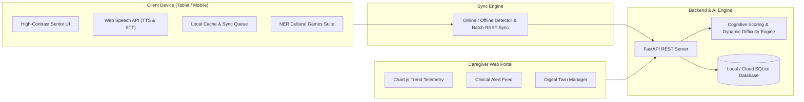

# CogniNER - AI-Based Cognitive Gaming & Memory Assistance for Elderly Dementia Patients (NER)

**Smart India Hackathon 2026** | **Problem Statement ID: 26003**  
**Theme:** MedTech / BioTech / HealthTech (Software)  
**Organization:** Ministry of Development of North Eastern Region (MDoNER)  
**Team Name:** Bug BusterZz  

---

## 🌟 Executive Summary

- **Challenge:** Dementia is rising among India's elderly (~5% of pop $\ge 65$ in 2011 $\to$ 14% by 2050). In the North Eastern Region (NER), geographic isolation, low connectivity, and scarcity of geriatric specialists compound the burden.
- **Solution:** **CogniNER** is an offline-first, culturally localized, voice-assisted cognitive companion app designed for tablets and mobile devices. It combines adaptive cognitive drills, routine adherence tracking, and a "Memory of Me" digital twin with a secure caregiver and clinical telemetry portal.
- **AI Innovation:** A dynamic difficulty engine recalculates composite Cognitive Performance Scores ($0.40 \times \text{Accuracy} + 0.30 \times \text{Speed} + 0.20 \times \text{Consistency} + 0.10 \times \text{Engagement}$) to adapt game challenge in real-time while detecting early signs of cognitive decline.

---

## 🎯 Key Features

1. **Elderly-Centric Accessibility & Voice Assistance**:
   - High-contrast, large typography (20px+ body text, 50px+ touch targets).
   - Multilingual voice reader and speech-to-text listener:
     - 🇬🇧 English
     - 🇮🇳 অসমীয়া (Assamese)
     - 🇮🇳 বাংলা (Bengali)
     - 🇮🇳 हिन्दी (Hindi)
   - Voice commands: *"Play game"*, *"Take medicine"*, *"What's my task?"*.

2. **4 NER Cultural Cognitive Games Suite**:
   - **Game 1: Assam Heritage Match**: Visual memory recall pairing Kaziranga Rhino, Bihu Dhol, Assam CTC Tea, Jaapi, Muga Silk, Majuli Mask, and Lakadong Spice.
   - **Game 2: Daily Routine Timeline Sequencer**: Chronological sequencing (Morning Tea $\to$ Morning BP Meds $\to$ Garden Walk $\to$ Family Call) to combat disorientation.
   - **Game 3: "Memory of Me" Digital Twin**: Recall of familiar relatives (Granddaughter Ananya, Son Pranab) and nostalgic NER hometowns (Majuli Island, Brahmaputra Ghat) with audio clues.
   - **Game 4: Speed of Processing Drill**: Tap-target reflex exercises (Bihu Dhol) with distractors measuring reaction latency without stress.

3. **AI Dynamic Difficulty Engine**:
   - Real-time scoring using reaction latency, accuracy, and error consistency.
   - Dynamic promotion/demotion between 🟢 **Easy**, 🟡 **Medium**, and 🔴 **Hard** tiers.
   - Automated clinical alerts when a drop $>12\%$ or reaction slowing is detected.

4. **Offline-First Synchronization**:
   - Operates completely without internet connectivity using local browser storage and SQLite.
   - Auto-detects network reconnections and flushes queued sessions to the cloud backend.

5. **Caregiver & Clinical Dashboard**:
   - 7-day cognitive performance trend curves (Chart.js).
   - Routine and medication adherence percentages with timestamped verification.
   - "Memory of Me" profile builder (add new family members, photos, and nostalgic stories).
   - Human-in-the-loop difficulty control (Auto-AI vs. Caregiver manual lock).
   - Printable clinical summary report for geriatrician appointments.

---

## 🛠️ Architecture & Tech Stack



- **Frontend**: Responsive HTML5, Accessible Modern CSS3, Vanilla JavaScript, Chart.js, Web Speech API, Web Audio API.
- **Backend**: Python 3.14, FastAPI, Uvicorn, Pydantic, SQLite3.
- **Testing**: Python `unittest`, `httpx`, `fastapi.testclient`.

---

## 🚀 Quickstart Guide

### 1. Launch the Application

In the project root directory, run:
```powershell
py run.py
```

The application will automatically:
1. Initialize the SQLite database with seed patient data, routines, and memories.
2. Launch the backend Uvicorn server on `http://localhost:8000`.
3. Open the app in your default web browser.

### 2. Access URLs
- **Elderly Patient App & Caregiver Portal:** [http://localhost:8000](http://localhost:8000)
- **Interactive API Documentation (Swagger UI):** [http://localhost:8000/docs](http://localhost:8000/docs)

### 3. Run Automated Tests
```powershell
py -m unittest discover -s tests -p "test_*.py"
```
*(All 12 automated unit and integration tests will execute and pass)*.

---

## 📋 Evaluation Metrics
- **Cognitive Score Formula**:
  $$\text{Score} = (0.40 \times \text{Accuracy}) + (0.30 \times \text{ReactionSpeedScore}) + (0.20 \times \text{Consistency}) + (0.10 \times \text{Engagement})$$
- **Reaction Speed Score**:
  $$\text{SpeedScore} = \max(20, \min(100, 100 - ((\text{reaction\_time\_ms} - 1500) / 4500) \times 70))$$
- **Medication Adherence**: Percentage of prescribed daily routines confirmed by patient or caregiver.
